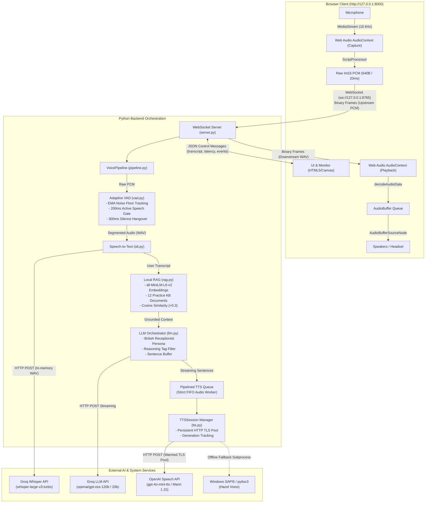
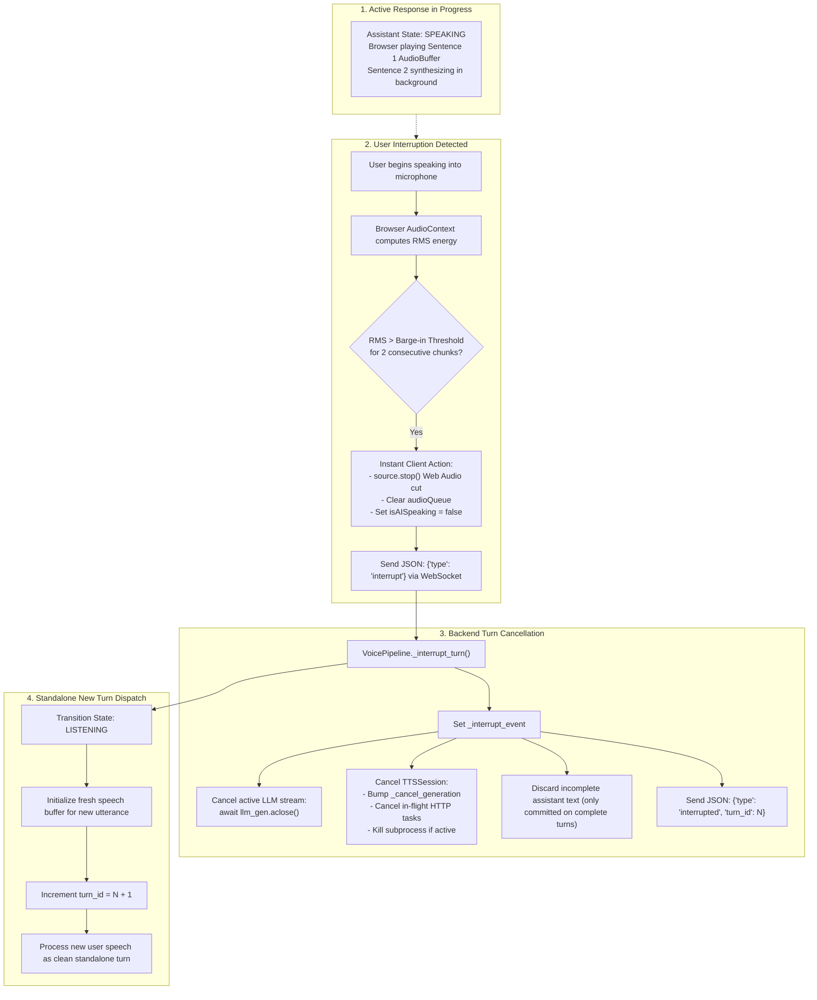

# Real-Time Voice Agent Demo

> **Real-time, low-latency, bidirectional voice dialogue demonstration system built from scratch.**  
> *Demonstrator: Oak Lane Medical Practice (Fictional NHS GP Receptionist)*

---

## 1. Project Overview & Demo Use Case

This project implements a real-time, browser-based voice AI agent designed for low-latency spoken dialogue with immediate barge-in interruption. Users speak naturally through their microphone and receive streaming neural voice responses.

### Custom Voice Orchestration (Built From Scratch)
The entire voice orchestration pipeline—including audio capture, Voice Activity Detection (VAD) with adaptive noise tracking, streaming Speech-to-Text (STT), in-memory semantic Retrieval-Augmented Generation (RAG), streaming LLM completion with reasoning filtering, non-blocking pipelined Text-to-Speech (TTS), and Web Audio API cancellation—is **custom built**.

This project does **not** rely on proprietary or managed voice orchestration platforms (such as LiveKit, Pipecat, Daily.co, Retell AI, or Vapi). Standard AI foundation models are integrated strictly as API endpoints (Groq for STT and LLM, OpenAI for Neural TTS, local `sentence-transformers` for embeddings).

### Intended Demo Use Case: Fictional GP Receptionist
For presentation, evaluation, and interview demonstration, the agent is configured as the digital receptionist for **Oak Lane Medical Practice**, a fictional NHS general practice. It handles patient enquiries with British English conversational prosody and strict factual grounding:
- **Routine Enquiries**: Practice opening hours, location, new patient registrations, clinics, and services.
- **Appointments & Cancellations**: Booking procedures, same-day vs. routine appointments, home visit criteria.
- **Repeat Prescriptions & Test Results**: 2 working-day processing times, nominated pharmacy dispatch, test result turnaround (3–5 days).
- **Out-of-Hours & Emergency Routing**: Immediate escalation to **999** for life-threatening symptoms; guidance to call **NHS 111** when closed.
- **Staff Contact Assistance**: When callers request human staff or ask questions outside practice documentation, the assistant explicitly states that this browser demo cannot transfer telephone calls and provides the surgery contact number (01632 960142).

---

## 2. Technology Stack & Component Architecture

| Subsystem | Technology | Specification / Model | Architectural Role |
|---|---|---|---|
| **Audio Capture** | Web Audio API | 16 kHz, 1-channel, 16-bit Int16 PCM | Browser-side microphone capture via `ScriptProcessorNode` (20 ms / 640-byte chunks) |
| **Transport** | WebSockets (`websockets`) | Binary PCM upstream, binary WAV downstream, JSON control | Full-duplex loopback communication (`ws://127.0.0.1:8765`) |
| **Frontend UI** | HTML5 / CSS3 / Vanilla JS | Web Audio API (`AudioContext`) | Waveform canvas visualizer, live per-turn latency HUD, transcript feed |
| **Audio Playback** | Web Audio API | `AudioBufferSourceNode` + dynamic buffer queue | Continuous chained playback; instant Web Audio API stop on interruption |
| **VAD** | Custom RMS Energy Detector | EMA dynamic noise floor, 200 ms active gate, 300 ms hangover | Real-time speech start/end segmentation (`vad.py`) |
| **STT** | Groq Cloud Whisper API | `whisper-large-v3-turbo` | Fast in-memory WAV transcription with domain vocabulary hints (`stt.py`) |
| **RAG** | `sentence-transformers` + NumPy | `all-MiniLM-L6-v2` (384-dim embeddings) | Local in-memory vector store, cosine similarity retrieval ($>0.3$) (`rag.py`) |
| **LLM** | Groq Cloud Chat API | `openai/gpt-oss-120b` (fallback: `openai/gpt-oss-20b`) | Streaming conversational generation with system prompt grounding (`llm.py`) |
| **TTS (Primary)** | OpenAI Speech API via `httpx` | `gpt-4o-mini-tts` (Voice: `marin`, Speed: `1.15`) | Low-latency neural British English conversational synthesis (`tts.py`) |
| **TTS (Fallback)** | Windows SAPI5 / `pyttsx3` | Microsoft Hazel (UK English) | Offline, zero-dependency subprocess speech synthesis (`tts.py`) |

---

## 3. System Architecture Diagram



---

## 4. End-to-End Voice Processing Flow

The system executes a single-turn-at-a-time lifecycle with concurrent, non-blocking sentence synthesis pipelining within each turn:

```mermaid
sequenceDiagram
    autonumber
    actor User
    participant Browser as Browser (Web Audio)
    participant WS as WebSocket Gateway
    participant VAD as VAD Engine
    participant STT as Groq Whisper
    participant RAG as Local Vector RAG
    participant LLM as Groq LLM
    participant TTS as Pipelined TTS
    participant OpenAITTS as OpenAI Speech API

    User->>Browser: Speaks query ("What are your opening hours?")
    Browser->>WS: Stream 20ms Int16 PCM chunks (640 bytes)
    WS->>VAD: Feed audio chunk
    Note over VAD: Energy > Speech Threshold (>=200ms active speech)
    VAD->>WS: Speech start detected (State: LISTENING)
    User->>Browser: Stops speaking
    Note over VAD: Silence hangover elapsed (300ms)
    VAD->>WS: Speech end detected (State: PROCESSING)
    WS->>STT: Transcribe in-memory WAV with vocabulary hints
    STT-->>WS: Return transcript ("What are your opening hours...")
    WS->>Browser: Send JSON control: {"type": "transcript", "text": "..."}
    WS->>RAG: Retrieve context for query
    RAG-->>WS: Return grounded context (opening_hours.txt)
    WS->>LLM: Stream conversation history + RAG context
    LLM-->>WS: First token generated
    WS->>Browser: Send JSON control: {"type": "latency", "llm_ttft_ms": ...}
    LLM-->>WS: Stream tokens into sentence buffer
    Note over WS: Sentence 1 boundary detected (".")
    WS->>TTS: Enqueue Sentence 1 synthesis task
    TTS->>OpenAITTS: POST /v1/audio/speech (Sentence 1, Marin @ 1.15)
    Note over LLM,WS: LLM continues generating Sentence 2 concurrently
    Note over WS: Sentence 2 boundary detected (".")
    WS->>TTS: Enqueue Sentence 2 synthesis task
    TTS->>OpenAITTS: POST /v1/audio/speech (Sentence 2, Marin @ 1.15)
    OpenAITTS-->>TTS: Sentence 1 WAV audio ready
    TTS->>WS: Worker receives Sentence 1 WAV
    WS->>Browser: Send JSON: {"type": "turn_start"} (State: SPEAKING)
    WS->>Browser: Send Binary WAV Chunk 1 (Sentence 1)
    Browser->>User: Play Sentence 1 audio (duration ~4.5s)
    Note over TTS,OpenAITTS: Sentence 2 finishes synthesizing while Sentence 1 is playing
    OpenAITTS-->>TTS: Sentence 2 WAV audio ready
    TTS->>WS: Worker receives Sentence 2 WAV
    WS->>Browser: Send Binary WAV Chunk 2 (Sentence 2)
    Note over Browser: Chunk 2 pre-buffered in AudioBuffer queue; plays seamlessly via onended
    WS->>Browser: Send JSON: {"type": "turn_end", "total_turn_ms": ...}
    Browser->>User: Complete playback (State: IDLE)
```

### Turn State Machine & Lifecycle Rules
The pipeline transitions through four deterministic states:
1. **`IDLE`**: Waiting for incoming microphone audio. VAD tracks the acoustic noise floor using an Exponential Moving Average (EMA). Short noise clicks ($<200$ ms) are discarded.
2. **`LISTENING`**: Active user speech detected. Audio frames accumulate in memory.
3. **`PROCESSING`**: Speech ended (silence hangover reached). STT, RAG, and LLM streaming are triggered.
   - *Speech continuation during `PROCESSING`*: If the user resumes speaking within $2.0$ seconds and total speech is strictly $<15.0$ seconds, the turn is cancelled and the audio buffers are merged into a single turn. If total audio reaches or exceeds $15.0$ seconds, the merge is rejected and the new utterance proceeds as a fresh standalone turn.
4. **`SPEAKING`**: First audio chunk transmitted over WebSocket. Browser plays audio buffers sequentially.
   - *Pipelined Synthesis*: Sentence 2 synthesizes concurrently over a persistent HTTP connection pool while Sentence 1 is transmitting or playing. Audio frames are delivered in strict FIFO order via a bounded queue (`maxsize=4`).

---

## 5. Barge-in / Interruption Flow

When the user speaks while the AI is responding (`SPEAKING` state), the pipeline executes a multi-layered cancellation to ensure true mid-sentence stop with zero audio bleeding:



### Barge-in Guarantees:
- **Instant Web Audio Cut**: The browser invokes `AudioBufferSourceNode.stop()` rather than HTML5 `<audio>.pause()`, cutting audio immediately at the Web Audio API rendering layer (exact hardware cut latency is uninstrumented).
- **Client Queue Flush**: Any downloaded but unplayed sentence chunks in `audioQueue` are discarded immediately.
- **Generation Counters**: Backend synthesis requests are tagged with an incrementing `_cancel_generation`. Any delayed or in-flight HTTP responses from cancelled turns are discarded upon arrival.
- **Provider Commitment Protection**: Once a turn starts outputting audio via OpenAI TTS, it commits to OpenAI. If an error occurs, mid-response voice switching to SAPI5 is strictly suppressed.

---

## 6. Local RAG & Knowledge Base Structure

The knowledge base is stored as plain text documents under [`knowledge_base/`](knowledge_base/). Each file is strictly focused, concise ($\le 600$ characters), and self-contained:

| File | Topic / Content | Key Policy Rules Grounded |
|---|---|---|
| `appointments.txt` | Routine & urgent booking | Same-day calls from 8:00 am; routine bookings 2 weeks ahead |
| `assistant_capabilities.txt` | Digital receptionist role | Information only; no direct medical advice or EHR writes |
| `cancellations.txt` | Appointment cancellation | Call reception on 01632 960142 as soon as possible, or reply CANCEL to SMS reminder |
| `clinics_and_services.txt` | Specialized surgery clinics | Asthma, diabetes, childhood immunisations, travel vaccines |
| `emergencies.txt` | Severe & acute symptoms | **Immediate 999 escalation** (chest pain, stroke, breathing difficulty) |
| `home_visits.txt` | Housebound patients | Requests strictly before 10:30 am; GP assessment required |
| `new_patients.txt` | Catchment & registration | NHS number, proof of address, registration form |
| `opening_hours.txt` | Surgery operating hours | Mon–Fri 8:00 am – 6:30 pm; **Closed weekends & bank holidays** |
| `out_of_hours.txt` | Urgent care when closed | **Call NHS 111**; Walk-in Centre 8:00 am – 8:00 pm |
| `practice_details.txt` | Surgery contact & location | Oak Lane Medical Practice, 14 Oak Lane, Highfield, HF2 4AB, phone: 01632 960142 |
| `repeat_prescriptions.txt` | Prescription requests | **2 working days** processing; dispatch to nominated pharmacy |
| `test_results.txt` | Blood tests & imaging | Call between 2:00 pm – 5:00 pm; turnaround 3–5 working days |

### Retrieval & Grounding Mechanism
- **Embeddings**: Documents are embedded once at server startup into memory using `all-MiniLM-L6-v2`.
- **Query Matching**: User queries are embedded and compared via dot-product cosine similarity.
- **Similarity Threshold**: Chunks with cosine similarity score $< 0.3$ are rejected to prevent hallucination on out-of-domain questions.
- **System Prompt Rules**: Grounding Rule 1 forbids assuming services not in the context. Grounding Rule 2 requires explicitly stating when services are closed or unavailable (e.g. Saturday closures).

---

## 7. Setup & Execution Instructions

### Prerequisites
- **Python**: Version 3.11 or 3.12 (tested on Python 3.12).
- **Browser**: Google Chrome, Microsoft Edge, or any modern Chromium-based browser supporting the Web Audio API.
- **Groq API Key**: Free tier available from [console.groq.com](https://console.groq.com) (required for STT & LLM).
- **OpenAI API Key**: Optional but recommended (enables OpenAI Neural TTS `gpt-4o-mini-tts` Marin voice; without it, the system falls back to offline Windows SAPI5 Hazel).

---

### 1. Installation

Clone the repository and initialize a virtual environment:

```powershell
# Clone the repository
git clone <repository-url>
cd SniperThink_task

# Create virtual environment
python -m venv .venv

# Activate virtual environment (Windows PowerShell)
.\.venv\Scripts\Activate.ps1

# Install exact pinned dependencies
pip install -r requirements.txt
```

---

### 2. Environment Configuration

Create a `.env` file in the root directory (based on `.env.template`):

```env
# Mandatory for Speech-to-Text and LLM streaming:
GROQ_API_KEY=gsk_your_groq_api_key_here

# Recommended for Neural British English TTS:
TTS_PROVIDER=openai
OPENAI_API_KEY=sk_your_openai_api_key_here
OPENAI_TTS_MODEL=gpt-4o-mini-tts
OPENAI_TTS_VOICE=marin
OPENAI_TTS_SPEED=1.15
```

#### Complete Configuration Reference

| Variable | Default Value | Description |
|---|---|---|
| `GROQ_API_KEY` | *(None)* | **Required.** Authentication key for Groq Whisper and LLM APIs. |
| `OPENAI_API_KEY` | `""` | Optional. Key for OpenAI `gpt-4o-mini-tts`. If unset, falls back to SAPI5. |
| `TTS_PROVIDER` | `openai` (if key set) else `sapi5` | `openai` for neural streaming TTS, or `sapi5` for offline synthesis. |
| `OPENAI_TTS_MODEL` | `gpt-4o-mini-tts` | OpenAI speech model identifier. |
| `OPENAI_TTS_VOICE` | `cedar` / `marin` | Voice selection (`marin` configured for brisk British receptionist tone). |
| `OPENAI_TTS_SPEED` | `1.15` | Speech playback rate multiplier (1.0 to 1.25). |
| `TTS_VOICE` | `Hazel` | SAPI5 fallback voice name preference. |
| `LLM_MODEL` | `openai/gpt-oss-120b` | Primary Groq model for dialogue response generation. |
| `LLM_FALLBACK_MODEL` | `openai/gpt-oss-20b` | Automatic fallback model if primary hits 429/500 errors. |
| `LLM_MAX_COMPLETION_TOKENS` | `400` | Maximum completion tokens allowed for receptionist turns. |
| `HOST` | `127.0.0.1` | Local loopback binding for WebSocket gateway. |
| `PORT` | `8765` | WebSocket gateway port. |
| `HTTP_PORT` | `8000` | Loopback static HTTP frontend port. |

---

### 3. Running the Server

Start the unified server with:

```powershell
python server.py
```

On startup, the server automatically executes:
1. **STT Warmup**: Transcribes a dummy buffer to pre-initialize the Groq connection.
2. **RAG Warmup**: Loads the `all-MiniLM-L6-v2` embedding weights and pre-indexes all 12 documents.
3. **TTS Warmup & Pool Establishment**: Pre-resolves DNS, negotiates TLS with OpenAI Speech API, and pools the keep-alive connection in `_warmed_tts_client`.
4. **Loopback HTTP Server**: Starts on `http://127.0.0.1:8000` with strict route isolation.
5. **WebSocket Gateway**: Listens on `ws://127.0.0.1:8765`.

---

### 4. Browser Client Connection

1. Open your browser to:
   ```
   http://127.0.0.1:8000
   ```
2. Click **Connect** (required by Chrome/Edge autoplay policy to unlock Web Audio).
3. Grant microphone permissions when prompted.
4. Speak naturally through your headset or microphone.

---

## 8. Latency & Performance Details

Metrics are measured live on every turn and displayed on the frontend HUD:

| Metric | Measurement Scope | Actual Measured Values (Single Local Run — Windows 11 Loopback) |
|---|---|---|
| **STT Latency (`stt_ms`)** | In-memory WAV dispatch to transcript return | **520 – 750 ms** |
| **RAG Retrieval (`rag_ms`)** | Query embedding + cosine similarity search | **20 – 35 ms** |
| **LLM TTFT (`llm_ttft_ms`)** | Time to first content token from LLM request | **700 – 1,115 ms** |
| **Time to First Audio** | User speech end to first binary audio frame sent | **~4.6 s** (OpenAI Neural TTS) / **~1.5 s** (SAPI5 Hazel) |
| **Inter-Sentence Delivery Gap** | Network arrival delta between consecutive sentences | **48.8 ms** (Sentence 2 arrives while Sentence 1 plays; audio is pre-buffered for seamless handover) |
| **Total Turn Duration** | User speech completion to final sentence delivery | **~4.7 s – 5.6 s** |

*Note: These figures represent single-session local measurements (tested on Windows 11 loopback with Groq whisper-large-v3-turbo, Groq openai/gpt-oss-120b, and OpenAI gpt-4o-mini-tts Marin at speed 1.15). Real-world latency varies with network distance, bandwidth, and upstream API load. Multi-client systematic load benchmarks have not been performed.*

---

## 9. Known Limitations & Explicit Non-Goals

- **Demonstration Scope**: This system is a browser-based WebSocket demonstration. It does **not** connect to telephony networks (SIP, RTP, PSTN) or NHS clinical databases (such as EMIS or SystmOne).
- **Synthetic Data**: All surgery details, staff names, doctors, phone numbers, and operational guidelines are synthetic.
- **No Clinical Compliance**: The assistant is strictly a receptionist for informational queries. It does not provide medical triage, diagnosis, or patient record handling.
- **300 ms Silence Hangover**: Turn completion relies on 300 ms acoustic silence. Long mid-sentence pauses exceeding 300 ms will trigger response generation; resuming speech acts as a barge-in rather than clause continuation.
- **Acoustic Environment**: The energy-based VAD uses dynamic noise-floor tracking suited for home or office acoustics; heavy background babble or noisy public spaces benefit from dedicated neural speech-separation models.
- **Cloud Dependency**: Speech recognition, LLM reasoning, and neural TTS rely on cloud APIs (Groq and OpenAI). In offline environments, SAPI5 provides local TTS, but STT and LLM require network connectivity.

---

## 10. Repository File Structure

```text
.
├── .env.template               # Template for environment configuration
├── config.py                   # Central configuration loading and validation
├── index.html                  # Browser frontend (Web Audio, canvas waveform, latency HUD)
├── llm.py                      # Groq LLM streaming, prompt grounding, model fallback
├── pipeline.py                 # Full VoicePipeline orchestrator & turn state machine
├── rag.py                      # In-memory vector store & cosine similarity search
├── requirements.txt            # Pinned Python package dependencies
├── server.py                   # WebSocket gateway + secured loopback HTTP server
├── session.py                  # Active pipeline session management
├── stt.py                      # Groq Whisper in-memory speech-to-text client
├── tts.py                      # TTSSession isolation, persistent TLS pool, SAPI5 fallback
├── vad.py                      # Energy-based VAD with active speech tracking & EMA floor
├── knowledge_base/             # 12 Oak Lane Medical Practice policy documents (<=600 chars)
│   ├── appointments.txt
│   ├── assistant_capabilities.txt
│   ├── cancellations.txt
│   ├── clinics_and_services.txt
│   ├── emergencies.txt
│   ├── home_visits.txt
│   ├── new_patients.txt
│   ├── opening_hours.txt
│   ├── out_of_hours.txt
│   ├── practice_details.txt
│   ├── repeat_prescriptions.txt
│   └── test_results.txt
├── scripts/                    # Dedicated evaluation and test scripts
│   ├── eval_openai_speed.py    # OpenAI speech rate & duration benchmarking
│   ├── eval_openai_tts.py      # OpenAI TTS integration verification
│   ├── prompt_eval.py          # LLM persona, emergency, and grounding validation
│   ├── rag_eval.py             # Standalone RAG retrieval hit/miss evaluation
│   └── tts_bakeoff.py          # Local SAPI5 voice comparison benchmark
└── tests/                      # Automated test suite (169 tests)
    ├── test_client_transcript.py
    ├── test_llm.py
    ├── test_metrics.py
    ├── test_pipeline_helpers.py
    ├── test_pipeline_lifecycle.py
    ├── test_rag.py
    ├── test_stt.py
    ├── test_tts_isolation.py
    └── test_vad.py
```

---

## 11. Testing & Verification Summary

The codebase is backed by 169 automated tests collected across 9 test modules:
- `tests/test_client_transcript.py`: 9 tests (transcript ordering, bubble stability, noise vs speech).
- `tests/test_llm.py`: 23 tests (token streaming, reasoning extraction, Groq fallback, prompt grounding, finish reason).
- `tests/test_metrics.py`: 3 tests (isolated latency measurement accuracy).
- `tests/test_pipeline_helpers.py`: 21 tests (sentence boundary edge cases, punctuation, comma length threshold).
- `tests/test_pipeline_lifecycle.py`: 27 tests (single-turn concurrency, turn cancellation, 15s merge boundary, barge-in, pipelined synthesis ordering).
- `tests/test_rag.py`: 14 tests (query embedding, cosine similarity matching, Saturday expansion).
- `tests/test_stt.py`: 27 tests (Whisper vocabulary prompt injection, non-speech caption filtering).
- `tests/test_tts_isolation.py`: 33 tests (subprocess reaping, temp file cleanup, persistent HTTP pooling reuse, SAPI5 fallback).
- `tests/test_vad.py`: 12 tests (EMA noise floor tracking, 200 ms active speech duration gate, impulse noise rejection).

*(Note: Live headset acoustic quality, microphone gain balance, and natural vocal delivery remain subject to manual human browser verification).*

---

## 12. License

This project is licensed under the MIT License.
